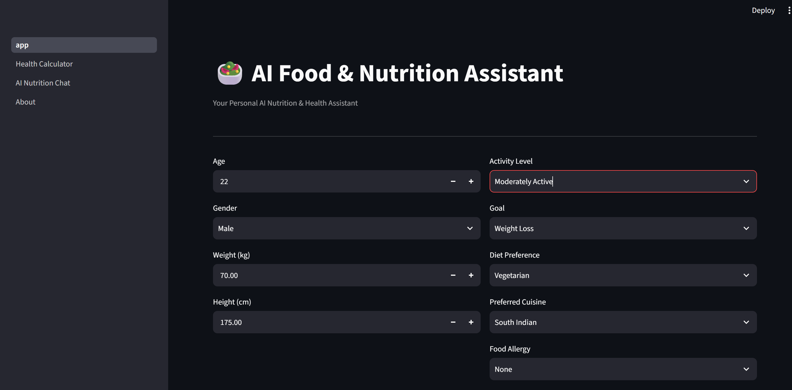
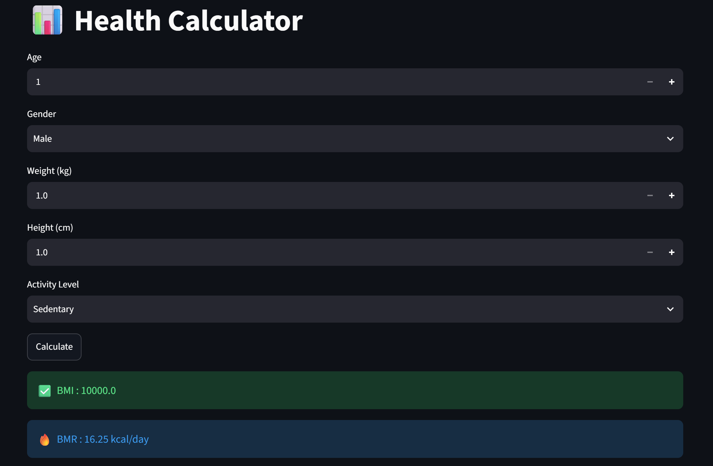
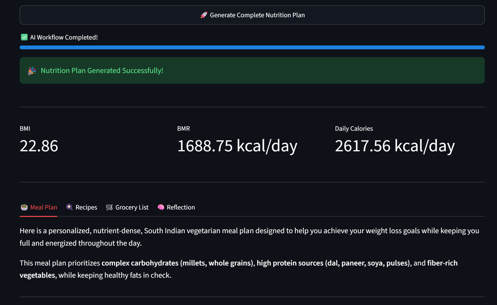
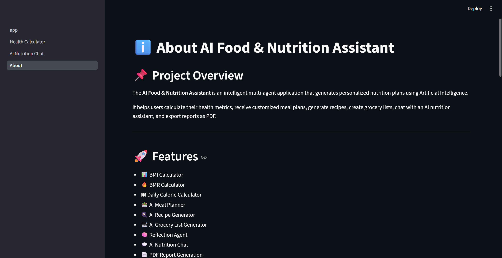

# 🥗 AI Food & Nutrition Assistant

An AI-powered multi-agent nutrition assistant that generates personalized meal plans, recipes, grocery lists, and health recommendations using Google Gemini AI.

---

## 📌 Project Overview

The AI Food & Nutrition Assistant helps users maintain a healthy lifestyle by generating personalized nutrition plans based on their age, gender, height, weight, activity level, dietary preferences, and health goals.

The application uses multiple AI agents to calculate health metrics, create meal plans, generate recipes, prepare grocery lists, provide nutrition advice, and export reports as PDF.

---

## ✨ Features

- 📊 BMI Calculator
- 🔥 BMR Calculator
- 🍽 Daily Calorie Calculator
- 🥗 AI Meal Plan Generator
- 🍳 AI Recipe Generator
- 🛒 AI Grocery List Generator
- 🧠 Reflection Agent
- 💬 AI Nutrition Chat
- 📄 PDF Report Generation
- 📱 Multi-Page Streamlit Application

---

## 🤖 AI Agents

### 📊 Health Agent
Calculates BMI, BMR, and daily calorie requirements.

### 🥗 Meal Agent
Generates a personalized meal plan based on user preferences.

### 🍳 Recipe Agent
Creates detailed recipes for every meal.

### 🛒 Grocery Agent
Generates a grocery shopping list.

### 🧠 Reflection Agent
Analyzes the generated nutrition plan and provides recommendations.

---

## 🛠 Technologies Used

- Python
- Streamlit
- Google Gemini API
- ReportLab
- Git
- GitHub

---

## 📂 Project Structure

```
AI-Food-Nutrition-Assistant
│
├── agents/
├── graph/
├── pages/
├── reports/
├── utils/
├── app.py
├── test_workflow.py
├── README.md
└── .gitignore
```

---

## 🚀 Installation

Clone the repository:

```bash
git clone https://github.com/PoojaRaghu-07/AI-Food-Nutrition-Assistant.git
```

Go to the project directory:

```bash
cd AI-Food-Nutrition-Assistant
```

Install dependencies:

```bash
pip install -r requirements.txt
```

Run the application:

```bash
streamlit run app.py
```

---

## 📷 Screenshots

### 🏠 Home Page



---

### 🧮 Health Calculator



---

### 🥗 Personalized Nutrition Plan



---

### 💬 AI Nutrition Chat


---

### ℹ️ About Page



---

## 🌟 Future Enhancements

- User Authentication
- Weekly Meal Planning
- Nutrition Charts
- Fitness Tracker Integration
- Cloud Database
- Voice Assistant

---

## 📄 License

This project was developed for educational and learning purposes as part of an Agentic AI training program.